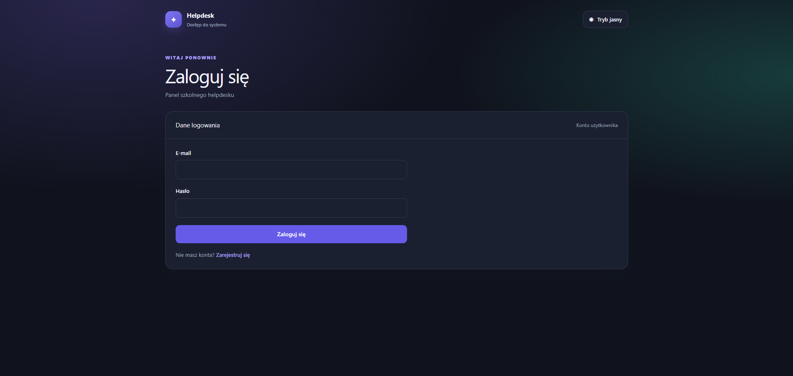
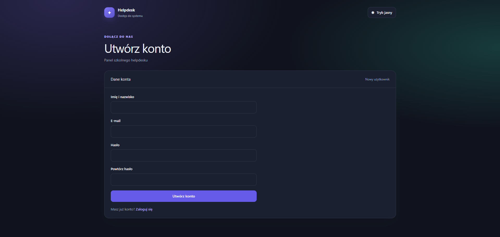
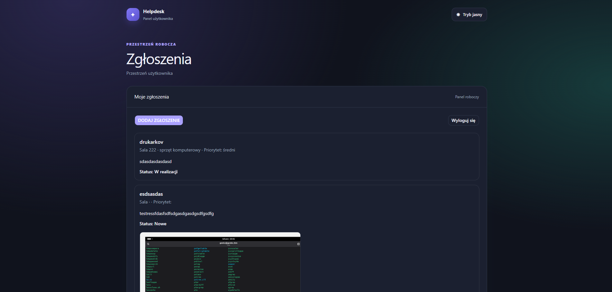
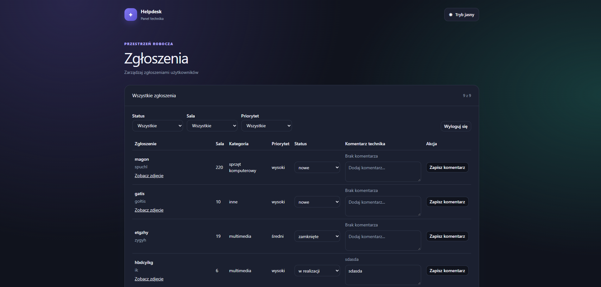

# Szkoła Helpdesk

## Opis projektu

Aplikacja webowa do obsługi zgłoszeń serwisowych i technicznych w szkole. Użytkownik może zarejestrować konto, dodać nowe zgłoszenie z opisem problemu, lokalizacją (np. sala), kategorią, priorytetem oraz załączonym zdjęciem. Technik otrzymuje widok wszystkich zgłoszeń, może je filtrować po statusie, sali i priorytecie, aktualizować status oraz dodawać komentarze do sprawy.

Projekt składa się z:
- front-endu w Next.js,
- backendu / bazy danych w PocketBase,
- logowania i rejestracji użytkowników,
- paneli użytkownika i technika,
- aktualizacji w czasie rzeczywistym (realtime).
## Zrzuty ekranu

Poniżej znajdziesz miejsca, w które należy wkleić zrzuty ekranu. Wstawiaj tylko odpowiednie grafiki i zachowaj nazewnictwo plików według własnego projektu.

### 1. Ekran logowania



### 2. Ekran rejestracji


### 3. Panel użytkownika


### 4. Panel technika



## Instrukcja uruchomienia lokalnie

### Wymagania
- Node.js 20+
- npm
- PocketBase (uruchomiony lokalnie lub jako osobna usługa)

### 1. Klonowanie repozytorium

```bash
git clone https://github.com/Michuaa/projekt-szkolahelpdesk
cd projekt-szkolahelpdesk
```

### 2. Instalacja zależności

```bash
npm install
```

### 3. Konfiguracja zmiennych środowiskowych

Utwórz plik `.env.local` w katalogu głównym projektu i dodaj adres PocketBase:

```env
NEXT_PUBLIC_POCKETBASE_URL=https://your-pocketbase.example.com
```

### 4. Uruchomienie PocketBase

Uruchom PocketBase lokalnie w katalogu projektu albo osobno na maszynie deweloperskiej. Należy zapewnić dostęp do API i panelu administracyjnego.

Przykładowo (jeśli PocketBase jest zainstalowany lokalnie):

```bash
pocketbase serve
```

W przypadku Docker / innej konfiguracji należy upewnić się, że:
- PocketBase jest dostępny pod adresem wskazanym w `NEXT_PUBLIC_POCKETBASE_URL`,
- dane są zapisane na trwałym wolumenie,
- kolekcje i reguły API są skonfigurowane zgodnie z wymaganiami aplikacji.

### 5. Uruchomienie aplikacji

```bash
npm run dev
```

Aplikacja będzie dostępna pod adresem:

```text
http://localhost:3000
```

### 6. Budowa produkcyjna

```bash
npm run build
npm run start
```

## Wdrożenie w Coolify

Poniżej znajduje się szablon opisu wdrożenia. Wypełnij pola według własnej konfiguracji środowiska.

### Usługi w Coolify

1. Usługa frontendowa: Next.js / aplikacja webowa
   - Nazwa: np. `szkola-helpdesk-web`
   - Budowanie: z repozytorium Git
   - Startup / komenda: `npm run start` (lub `npm run dev` tylko dla środowiska deweloperskiego)
   - Port: `3000`

2. Usługa backendowa: PocketBase
   - Nazwa: np. `szkola-helpdesk-pb`
   - Typ: aplikacja / serwer bazy i API
   - Port: `8090` (lub inny zgodnie z konfiguracją)
   - Katalog danych: ustaw na wolumen trwały

### Wolumeny

Trzeba mieć oddzielny trwały wolumen dla PocketBase, aby dane nie były usuwane po redeployu.

Przykładowa konfiguracja:
- `pb_data` -> `/pb` albo `/app/pb_data`
- lokalizacja danych PocketBase: katalog z bazą, kolekcjami, migrujami i plikami użytkowników / zgłoszeń

Ważne:
- wolumen dla PocketBase musi być trwały,
- nie kasuj go przy kolejnym wdrożeniu,
- jeżeli app korzysta z plików z załączników, upewnij się, że są one przechowywane w katalogu danych PocketBase.

## Konta testowe

Poniżej zostawiono miejsca do wstawienia danych testowych. Nie wpisuj danych fikcyjnych — uzupełnij je po stronie projektu / środowiska testowego.

### Konto użytkownika
- Email: michal.plochocki.pro@live.zs1mm.edu.pl
- Hasło: Fokusi123
- Rola: użytkownik końcowy

### Konto technika
- Email: fokusi297@gmail.com
- Hasło: admin123
- Rola: technik / administrator panelu technicznego
